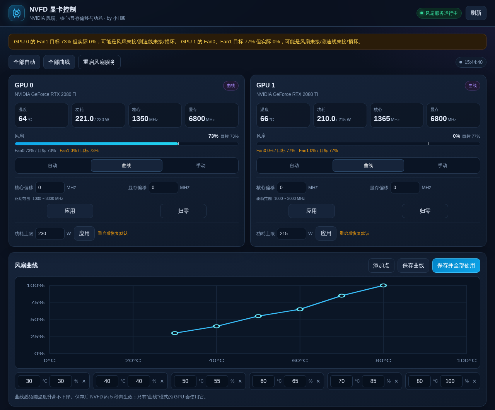

# NVFD for Synology DSM

[](#平台)
[](LICENSE)

在群晖 DSM 网页里用鼠标控制 NVIDIA 显卡风扇、风扇曲线、核心/显存偏移和功耗上限。

> **注意：** 调整风扇、核心/显存偏移、功耗上限均有风险，可能导致显卡不稳定、
> 计算任务出错、驱动崩溃或硬件损坏，请谨慎操作、风险自负。
>
> **安装后必须**在群晖 `SimplePermissionManager` 中授权 `NVFD`，否则网页后端
> 无法控制 GPU。详见下方“SimplePermissionManager 授权”一节。

作者：**小H酱**
项目地址：**https://github.com/MeowPerth/nvfd-synology-spk**

**下载：** [GitHub Releases](https://github.com/MeowPerth/nvfd-synology-spk/releases/latest)



> 上图使用模拟数据渲染；实际界面会显示你的显卡温度、风扇和频率。

## 功能

- 两张或多张 NVIDIA GPU 的实时状态：温度、功耗、核心/显存频率、每个风扇的实际/目标转速
- 每张卡独立选择 **自动 / 曲线 / 手动**
- 手动风扇 30–100%
- 可视化风扇曲线编辑（加点、删点、保存、全部应用）
- NVML VF 偏移：核心 -1000…+1000 MHz，显存范围实时读取驱动报告并换算为实际 MHz（本机约 -1000…+3000 MHz）
- 功耗上限设置
- NVFD 守护进程的失效保护：GPU 到 86 °C 时强制 100% 风扇
- 停止套件时自动把风扇交回驱动控制

## 平台与前提

| 项目 | 要求 |
|---|---|
| DSM | **7.2 及以上** |
| CPU | **x86_64**（包内声明 `epyc7002 x86_64`） |
| 实测 | SA6400 / DSM 7.4.0-90075 / 内核 5.10.55 |
| 显卡 | NVIDIA GPU，已安装可用的官方驱动 |
| 驱动 | **R520+**，需要 `libnvidia-ml.so.1` |
| 实测显卡 | 2 × RTX 2080 Ti，驱动 615.78.08 |
| 依赖 | `SimplePermissionManager`（DSM 7 的第三方套件提权机制） |

不支持 DSM 6.x、ARM 机型、AMD 显卡或没有 NVIDIA 驱动的群晖。

## 安装

1. 从 [dist/NVFD-1.0.0-0014.spk](dist/NVFD-1.0.0-0014.spk) 下载 SPK。
2. DSM **套件中心 → 手动安装**，选择这个文件。
3. 本地自制包没有 Synology 官方签名；若提示“来源不受信任”，选择继续/允许。
4. 安装后如果按钮是“启动”，点 **启动**。
5. 从 **DSM 主菜单 → NVFD 显卡控制**，或 **套件中心 → NVFD → 打开**。

如果主菜单没有立即出现图标，刷新 DSM 页面或重新登录。

## 重要：SimplePermissionManager 授权

DSM 7 的第三方套件网页默认以普通用户运行，不能直接操作 GPU。本套件通过 DSM
自带的 `spm-exec` 调用 root 后端，因此需要把 `NVFD` 加入
`SimplePermissionManager` 的允许列表。

正常安装且已授权时，安装脚本会自动完成。以下情况需要手动修复：

- 第一次在另一台 NAS 上安装
- 重装套件后 `NVFD` 用户 UID 变化
- 更新了 SimplePermissionManager
- 界面报 `backend execution failed`，或套件启动失败

修复命令：

```bash
sudo /var/packages/NVFD/target/tools/approve-nvfd.sh
sudo synopkg start NVFD
```

脚本会：

1. 按当前 `NVFD` 用户的 UID/GID 写入
   `/var/packages/SimplePermissionManager/etc/permissions.json`
2. 备份原文件为 `permissions.json.bak.nvfd`
3. 安装 `nvfd.service`、补齐 `/etc/nvfd` 默认配置并启动服务

如果 `SimplePermissionManager` 没有安装，需要先从 SynoCommunity 安装它。

## 使用

打开界面后：

- **自动**：交回 NVIDIA 驱动
- **曲线**：按温度曲线控制
- **手动**：固定百分比
- **核心/显存偏移**：都按实际 MHz 输入，点“应用”；“归零”恢复 0
- **功耗上限**：点“应用”立即生效（重启后恢复默认）
- **重启风扇服务**：重启 `nvfd.service`

### 显存偏移按实际 MHz 输入

界面显示和输入的是**实际显存时钟 MHz**，内部再换算成 NVML 的 MT/s 偏移（×2）：

```text
界面输入 -800 MHz  ->  NVML -1600 MT/s  ->  实际显存时钟约降低 800 MHz
界面输入 +50 MHz   ->  NVML +100 MT/s   ->  实际显存时钟约升高 50 MHz
```

核心和显存的输入框 `min`/`max` 会**实时读取驱动报告的范围**，显存范围再除以 2
换算成实际 MHz。本机驱动报告：

```text
NVML:  -2000 … +6000 MT/s
界面:  -1000 … +3000 MHz
```

如果输入超过 `-1000 … +3000 MHz`，后端会拒绝。换显卡或换驱动后，范围会自动变化。
命令行 `nvfd-clocks` 仍使用 NVML 的 MT/s 单位。

命令行仍然可用：

```bash
sudo nvfd status
sudo nvfd 0 60
sudo nvfd auto
sudo nvfd-clocks status
sudo nvfd-clocks set all -50 0
sudo nvfd-clocks reset
```

## 套件管理

```bash
sudo synopkg status NVFD
sudo synopkg start NVFD
sudo synopkg stop NVFD
sudo synopkg uninstall NVFD
```

停止套件会把风扇交回驱动自动控制；卸载保留 `/etc/nvfd` 配置。

## 构建

仓库已经包含编译好的 `package/bin/nvfd`，在 Linux 上直接打包：

```bash
./build.sh
```

输出：

```text
dist/NVFD-1.0.0-0014.spk
```

`build.sh` 需要 `python3` 和 GNU tar；不需要在 NAS 上安装编译器。

`package/bin/nvfd` 来自 [infinirc/nvfd](https://github.com/infinirc/nvfd)（MIT），
在 Debian 12 / glibc 2.36 环境编译，运行时只依赖 `libc` 和
`libnvidia-ml.so.1`。如果要替换二进制：

```bash
NVFD_BIN=/path/to/nvfd ./build.sh
```

## 目录结构

```text
.
├── INFO                     # DSM 套件元数据
├── build.sh                 # 打包脚本
├── conf/privilege           # 套件权限
├── scripts/                 # 安装/启动/卸载脚本
├── package/
│   ├── bin/                 # nvfd、nvfd-clocks、backend.py
│   ├── etc/                 # 默认配置
│   ├── systemd/             # nvfd.service
│   ├── tools/               # approve-nvfd.sh
│   └── ui/                  # DSM 网页界面 + api.cgi
├── dist/                    # 构建出的 SPK
└── docs/                    # 截图和命令说明
```

## 已知现象

如果某个风扇“目标转速 > 0”但“实际转速 = 0”，界面会显示黄色提醒。常见原因是
风扇未接、测速线未接、改水冷或风扇损坏。当前测试机 GPU 1 的两个风扇就是这种
情况，但满载温度仍在 64–68 °C，暂未过热。软件无法区分“故意不接”和“故障”。

## 许可证与声明

- 本项目打包、网页界面和后端：MIT，作者 **小H酱**
- `nvfd` 上游：[infinirc/nvfd](https://github.com/infinirc/nvfd)，MIT
- 使用风险自负。不当的风扇/频率/功耗设置可能影响硬件稳定性或正在运行的任务。
